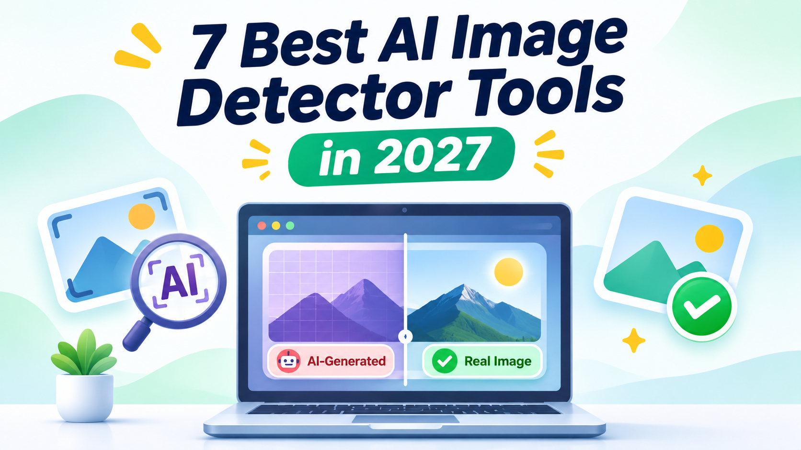

# 7 Best AI Image Detector Tools in 2027

AI-generated images are becoming more realistic every day. Tools like Midjourney, DALL·E, and other AI generators can create pictures that look like real photographs.

An [**AI Image Detector**](https://www.yttags.com/) helps users check whether a picture may have been created or modified using artificial intelligence. It can be useful for photographers, designers, journalists, students, and businesses.

In this guide, we compare 7 AI image detection tools. Explore their features, advantages, disadvantages, pricing, and reviews to find the right option for your needs.

## Quick Comparison of the 7 Best AI Image Detectors

| Tool | Best For | Free Option | Starting Price |
|---|---|---|---|
| **Winston AI** | Professional image verification | Trial available | Around $18/month |
| **Hive AI Detector** | Business and platform screening | Free demo | Usage-based |
| **Sightengine** | Developers and moderation | 2,000 free operations/month | $29/month |
| **AI or Not** | Quick image checks | Free credits | $5/month |
| **WasItAI** | Everyday image verification | Limited free checks | $3.99/month |
| **Illuminarty** | Visual analysis and heatmaps | Limited free checks | $10/month |
|**Content Credentials Verify** | Checking image origin and history | Free | Free |

*Prices are approximate USD amounts based on available plan information. Billing periods, credits, and features can change. Always check current pricing before subscribing.*

### 🚀 [Explore AI Detection Tools →](https://www.yttags.com/ai-detectors/)

## 1. Winston AI

**Best For:** Publishers, educators, and professional image verification

Winston AI is a content verification platform that offers AI image detection and deepfake analysis. It helps users investigate whether an image may have been generated or manipulated using artificial intelligence.

The platform provides image analysis and additional forensic information to support a closer review. It is useful for publishers, educational teams, and businesses that regularly examine digital content. Users can also access other content checking features within the same platform.

### Key Features

- AI-generated image detection.
- Deepfake image analysis.
- Image probability results.
- Advanced forensic analysis.
- Metadata and image information checks.
- AI text detection.
- Reports and team-oriented features.
- Support for professional content review.

### Pros & Cons

| Pros | Cons |
|---|---|
| Offers image and deepfake detection | Paid access is needed for regular use |
| Provides additional forensic information | Some features may take time to understand |
| Useful for publishers and educators | Results are not guaranteed |
| Combines multiple content review features | May be costly for occasional users |
| Supports professional workflows | Credit limits depend on the plan |

### Pricing

- **Free Trial:** Limited trial access with credits.
- **Paid Plan:** Starting price is approximately $18/month.
- **Higher Plans:** More credits and additional features are available.
- **Enterprise:** Custom pricing may apply.

### Review

Winston AI is a useful choice for people who need more than a basic image checker. Its forensic features can help users investigate suspicious pictures and understand the available image information.

It is particularly suitable for publishers and professional teams. However, an AI probability score should not be treated as proof. Compare the result with the image source and other available evidence before making a decision.

### 🎨 [Detect AI-Generated Images →](https://www.yttags.com/ai-image-detector/)

## 2. Hive AI Detector

**Best For:** Businesses, content moderation, and large image collections

Hive AI Detector is designed to identify potentially AI-generated images and other synthetic media. It is especially useful for websites, online communities, and businesses that receive large numbers of uploaded pictures.

The platform uses detection models to examine visual patterns and estimate whether an image may have been created using AI. It also offers API-based services, allowing developers to connect image detection with their own applications.

### Key Features

- AI-generated image detection.
- Synthetic image classification.
- Image and video moderation.
- Detection API for developers.
- Automated content screening.
- Support for large-scale workflows.
- Additional media detection services.
- Business-focused integration options.

### Pros & Cons

| Pros | Cons |
|---|---|
| Suitable for business use | Advanced setup may require technical skills |
| Supports automated image checks | Pricing depends on usage |
| Offers multiple detection services | Results can vary across image types |
| Useful for large platforms | Not as simple as basic upload tools |
| API integration is available | Custom requirements may need support |

### Pricing

- **Free Access:** A web demo is available for trying selected features.
- **Image API:** Approximately $6 per 1,000 image requests.
- **Higher Usage:** Costs depend on the number of requests.
- **Enterprise:** Custom arrangements may be available.

### Review

Hive is a strong option for organizations that need image detection at scale. Its API can help automate the review of pictures submitted by users, reducing the need for manual checking.

It is more suitable for businesses and developers than for people who only want to check one or two images. If your work involves content moderation or large image libraries, Hive is worth considering.

### 🎤 [Discover the Best AI Voice Detectors →](https://www.yttags.com/7-best-ai-voice-detectors/)

## 3. Sightengine

**Best For:** Developers, websites, and automated content moderation

Sightengine is an image and video analysis platform that includes AI-generated image detection. It helps businesses examine uploaded pictures and identify potentially synthetic or manipulated content.

One of its main advantages is its API. Developers can connect Sightengine with websites, mobile applications, and content management systems. It also provides other moderation features, making it useful for platforms that need to review different types of visual content.

### Key Features

- AI-generated image detection.
- Image content moderation.
- Video analysis.
- Deepfake-related detection models.
- Face and visual content analysis.
- API integration.
- Automated image screening.
- Multiple moderation services.

### Pros & Cons

| Pros | Cons |
|---|---|
| Developer-friendly API | Beginners may need technical knowledge |
| Supports image and video moderation | Costs can increase with usage |
| Offers free monthly operations | Some advanced features require payment |
| Useful for automated workflows | Results are not always conclusive |
| Suitable for business applications | Interface may feel technical |

### Pricing

- **Free Plan:** Approximately 2,000 operations per month.
- **Paid Plan:** Starts at around $29/month.
- **Additional Usage:** Extra operations may have separate charges.
- **Business Plan:** Pricing depends on requirements and usage.

### Review

Sightengine is a practical option for developers who want to add AI image detection to their applications. Its moderation features make it useful for businesses that need to check images automatically.

The free allowance is helpful for testing the service before purchasing. However, users should understand the difference between AI image detection and general content moderation when selecting features.

### 🎥 [Check AI-Generated Videos →](https://www.yttags.com/ai-video-detectors/)

## 4. AI or Not

**Best For:** Quick AI image checks and digital content verification

AI or Not is an online detection platform that helps users examine whether a picture may have been created using artificial intelligence. It is designed for people who want a straightforward way to check suspicious digital content.

Users can submit supported files and receive an assessment. The platform also supports other media types, including audio and video, making it useful for creators, businesses, and people who work with different digital formats.

### Key Features

- AI-generated image detection.
- Image authenticity checks.
- AI audio detection.
- Video detection options.
- Text detection features.
- API access.
- Credit-based usage.
- Support for different digital media workflows.

### Pros & Cons

| Pros | Cons |
|---|---|
| Easy to use | Free credits are limited |
| Supports multiple media types | Usage costs depend on the task |
| Useful for quick checks | Results require human verification |
| Offers API access | Advanced use may require payment |
| Suitable for different content workflows | Not a complete forensic investigation tool |

### Pricing

- **Free Credits:** $5 in starting credits.
- **Pro Plan:** Approximately $5/month.
- **Image Detection:** Around $0.02 per image.
- **Other Media:** Audio, video, and text checks may have separate rates.
- **Enterprise:** Custom options may be available.

### Review

AI or Not is a convenient option for users who want to check images without using complicated software. Its support for different media types is a useful advantage.

It can be helpful for content creators, online businesses, and people who regularly review digital files. Before using it for large projects, estimate your expected credit usage and compare the cost with other platforms.

### 📊 [Explore YouTube Growth Services →](https://www.yttags.com/best-sites-to-buy-youtube-views/)

## 5. WasItAI

**Best For:** Everyday users and quick image verification

WasItAI is an AI image detection service designed for people who want to check whether a picture may have been generated using artificial intelligence. It offers a simple approach to image verification and can be useful when reviewing pictures found on websites or social media.

The platform is suitable for casual checks and users who do not need a complicated professional system. Its API options can also help developers who want to include image checking in their own workflows.

### Key Features

- AI-generated image detection.
- Online image checking.
- Confidence-based results.
- Browser-focused checking workflow.
- API options.
- Support for everyday image verification.
- Additional usage options for regular users.

### Pros & Cons

| Pros | Cons |
|---|---|
| Simple image checking process | Fewer advanced forensic features |
| Suitable for everyday users | Results are not guaranteed |
| Offers API options | Free checks may be limited |
| Useful for quick second opinions | Not ideal for complex investigations |
| Affordable entry-level pricing | Detection can vary with edited images |

### Pricing

- **Free Access:** Limited image checks may be available.
- **Paid Plan:** Starts at approximately $3.99/month.
- **API Usage:** Additional options may depend on the selected plan.
- **Higher Usage:** Check the current subscription limits.

### Review

WasItAI is worth considering if you need a simple image detector for occasional use. Its straightforward workflow makes it accessible to people without technical knowledge.

It can provide an initial opinion about a suspicious picture, but it should not be the only tool used for important verification. Compare its result with another detector and check the image's source whenever possible.

### 📑 [Verify PDF Documents Online →](https://www.yttags.com/fake-pdf-detector/)

## 6. Illuminarty

**Best For:** Visual image analysis and suspicious-area detection

Illuminarty is an AI image detection platform that helps users examine pictures for signs of artificial generation. One of its useful features is visual analysis, which can highlight areas that may have influenced the detection result.

Instead of relying only on a simple classification, users can get additional context about suspicious regions. This can be helpful for designers, researchers, journalists, and people who want to investigate an image more closely.

### Key Features

- AI-generated image detection.
- Image probability analysis.
- Visual heatmap features.
- Suspicious-region highlighting.
- Image analysis for selected AI models.
- API options on supported plans.
- Additional tools for content investigation.

### Pros & Cons

| Pros | Cons |
|---|---|
| Provides visual analysis | Free checks may have limits |
| Helps identify suspicious regions | Heatmaps are not definite proof |
| Useful for detailed image reviews | Results can vary by image |
| Offers different usage options | Advanced features may require payment |
| Suitable for researchers and designers | Not a complete forensic platform |

### Pricing

- **Free Access:** Limited image checks are available.
- **Basic Plan:** Starts at approximately $10/month.
- **Higher Plans:** More requests and additional features may be included.
- **API Usage:** Availability depends on the selected plan.

### Review

Illuminarty is a useful option when you want more information than a basic AI detection score. Its heatmap-style analysis can help you focus on particular parts of an image.

It is especially helpful for users who want to investigate suspicious visual details. However, a highlighted region does not automatically mean that the image was created by AI. Always compare the result with other information.

### 🧾 [Detect Fake Receipts Easily →](https://www.yttags.com/5-best-fake-receipt-detectors/)

## 7. Content Credentials Verify

**Best For:** Checking image origin, creator information, and editing history

Content Credentials Verify is different from traditional AI image detectors. Instead of trying to guess whether an image looks AI-generated, it checks for Content Credentials attached to supported files.

These credentials can provide information about an image's origin and editing history when the creator or software has added signed provenance information. This makes it useful for journalists, photographers, publishers, and people who want to understand where a picture came from.

### Key Features

- Content Credentials inspection.
- C2PA provenance verification.
- Creator and source information when available.
- Supported editing history details.
- Cryptographic signature verification.
- Helps identify available content history.
- Free verification access.

### Pros & Cons

| Pros | Cons |
|---|---|
| Free to use | Not a universal AI image detector |
| Checks signed provenance information | Many images have no credentials |
| Can show available editing history | Missing credentials do not prove an image is fake |
| Useful for journalism and publishing | Depends on supported credentials |
| Provides stronger evidence when signatures are valid | Cannot identify every AI-generated image |

### Pricing

- **Free:** No standard monthly subscription is required.
- **Image Verification:** Available without a paid detector plan.
- **Business Use:** Other content credential services may have separate requirements.

### Review

Content Credentials Verify is a valuable addition to an image verification workflow. It checks whether supported provenance information exists and whether the available credentials are valid.

Its biggest advantage is that signed provenance can provide more meaningful evidence than a detector's probability score. However, not every image contains Content Credentials. If no information is found, that does not mean the image is fake or AI-generated.

### 🪪 [Check ID Document Authenticity →](https://www.yttags.com/fake-id-detector/)

## How Does an AI Image Detector Work?

An AI image detector examines different visual signals to estimate whether a picture may have been generated or modified using artificial intelligence.

The exact process depends on the platform, but most detection systems use a combination of these methods.

### 1. Pixel-Level Analysis

The detector examines pixels, textures, and small image details. AI-generated pictures may contain patterns that differ from ordinary photographs.

### 2. Pattern Recognition

Machine learning models compare an uploaded picture with patterns learned from real and AI-generated images. The system uses these patterns to estimate the image's likely origin.

### 3. Image Metadata

Some tools inspect available file information, such as creation details and editing history. However, metadata can be removed or changed when an image is uploaded, downloaded, or edited.

### 4. Visual Heatmaps

Some detectors highlight areas that may have influenced their results. This can help users understand which parts of an image deserve closer attention.

### 5. Result Generation

After analysis, the platform may provide a probability score, classification, or report. This result is an estimate, not guaranteed proof.

## Benefits of Using an AI Image Detector

AI image detection tools can support different types of digital content verification.

- **Image verification:** Helps investigate pictures that may have been generated by AI.
- **Content moderation:** Supports websites that review user-uploaded images.
- **Misinformation checks:** Helps examine suspicious pictures shared online.
- **Business protection:** Adds another review step for digital content.
- **Time savings:** Automated tools can screen images faster than manual checking.
- **Creative review:** Helps photographers and designers investigate visual content.
- **Research support:** Provides additional information for image investigations.

## How to Choose the Best AI Image Detector

The right tool depends on your purpose, budget, and expected number of image checks. Consider these points before selecting a platform.

### 1. Detection Capabilities

Check whether the tool detects fully AI-generated images, edited images, face swaps, or deepfakes. These are different detection tasks, and not every platform supports all of them.

### 2. Accuracy and False Positives

Look for transparent testing information rather than relying on advertised accuracy percentages. A good detector should be evaluated on both AI-generated images and genuine photographs.

### 3. Supported Image Formats

Check whether the platform supports common formats such as JPG, JPEG, PNG, and WEBP. Also review file-size limits and upload restrictions.

### 4. Pricing and Free Limits

Compare free checks, monthly plans, credits, and API charges. If you only check a few images, a free plan may be enough.

### 5. Privacy and Security

Read the privacy policy before uploading personal or confidential images. Check how files are stored, processed, and retained.

### 6. Reports and Integrations

If you work with a team, look for downloadable reports, API access, and automated workflows. These features can make regular image verification easier.

For additional digital tools and resources, explore the [YTTags Tool collection](https://sites.google.com/view/yttags-tool).

## AI Image Detection vs. Image Editing

AI image detection and AI image editing serve different purposes.

An AI image detector examines a picture to estimate whether it may have been generated or manipulated. An AI photo editor helps users improve, modify, or create images.

For example, detection tools can help investigate suspicious pictures, while editing tools can remove backgrounds, improve image quality, or apply creative effects.

If your goal is to edit pictures rather than verify them, explore this [Best AI Photo Editor collection](https://github.com/best-AI-Photo-Editor).

## Are AI Image Detectors 100% Accurate?

No. AI image detectors can make mistakes. A genuine photograph may receive an AI-generated score, while a synthetic image may pass detection.

Several factors can affect the result:

- **Compression:** Social media platforms may reduce image quality.
- **Cropping:** Removing image areas can change the signals available for analysis.
- **Editing:** Filters, retouching, and other modifications can affect detection.
- **Screenshots:** Screenshots may remove original metadata.
- **New AI models:** New image generators may produce pictures that older detectors do not recognize.
- **Mixed images:** A real photograph with one AI-edited section can be difficult to classify.

For important decisions, compare more than one detector and check the image's source, available metadata, and surrounding context.

You can also read this [10 Best AI Detector Tools Honest Review](https://github.com/10-Best-AI-Detector-Tools-Honest-Review) for another perspective on AI detection tools.

## Frequently Asked Questions About AI Image Detectors

### 1. What is an AI Image Detector?

An AI Image Detector is a tool that examines a picture and estimates whether it may have been created or modified using artificial intelligence. It may provide a score, classification, or visual report.

### 2. Which AI Image Detector is best in 2026?

The best option depends on your requirements. Winston AI is suitable for professional reviews, Hive works well for business screening, Sightengine is useful for developers, and Illuminarty offers visual analysis.

### 3. Are there free AI Image Detectors?

Yes. Several platforms offer free checks, trial credits, or limited access. Content Credentials Verify is also free for checking supported provenance information.

### 4. Can AI detectors identify Midjourney images?

Some tools can identify patterns associated with popular AI image generators, including Midjourney. However, detection is not guaranteed, especially if the image has been edited or compressed.

### 5. Can an AI detector identify edited images?

Some tools can detect signs of AI-based image manipulation. However, identifying a fully generated image and finding a small AI-edited section are different tasks.

### 6. Can businesses use AI image detectors?

Yes. Platforms such as Hive and Sightengine offer API services that can support automated image screening. Businesses should review pricing, privacy, and integration requirements before implementation.

### 7. Should I trust an AI detection score?

No single score should be treated as final proof. Compare results from different tools and investigate the image's source and available information.

## Final Thoughts

AI-generated pictures are becoming harder to distinguish from real photographs. AI image detectors can help users examine suspicious images, review digital content, and make more informed decisions.

Winston AI, Hive, and Sightengine are useful for professional workflows. AI or Not and WasItAI offer convenient checks, while Illuminarty provides visual analysis. Content Credentials Verify adds another way to inspect an image's origin when signed information is available.

Choose a tool based on your needs, budget, and required features. Most importantly, remember that a detector score is an estimate, not proof. Use multiple verification methods before making important decisions.
